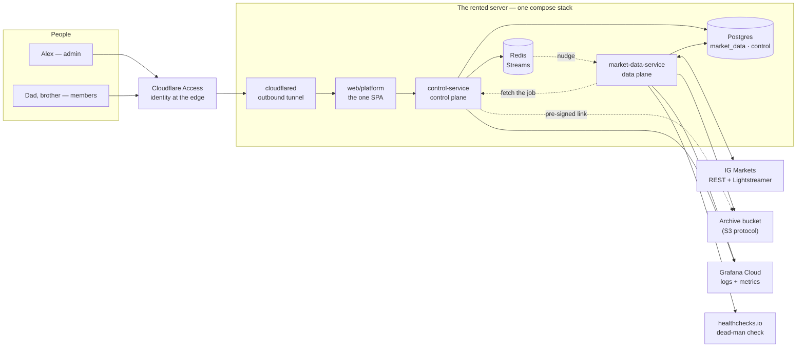

# The platform: deployables, ownership and identity

> **What this is.** The system-level page: every deployable Tradebench runs, what each one
> owns, who may reach what, and with which identity. The [architecture overview](README.md) goes
> one level down (modules, seams, key behaviours); the
> [component reference](components/README.md) one further. Rulings trace to
> `docs/decisions.md` — chiefly D17 (databases), D24 (the edge), D30 (who reports), D31 (the
> platform app and `control-service`), D32 (identity and trust), D33 (telemetry). **Keep-current
> duty:** update this page whenever a deployable, a database, a stream or a bucket is added, or
> an owner or a role changes.
>
> Status: v1, 2026-10-16 — written at E1-T6's design nod. **Built:** `market-data-service`,
> its database, the docs site. **Ruled, not yet built:** `web/platform`, `control-service` and
> its database, Redis, the archive bucket, the telemetry export, the dead-man ping. The hosting
> provider is chosen at E1-T7's provider analysis; nothing here depends on which.

## 1. Two planes

Tradebench is split into a **data plane** and a **control plane**, and every deployable belongs
to exactly one.

- **The data plane** gets market data off the wire and keeps it: `market-data-service`. It
  streams, stores, heals and archives, and writes down what it did as rows. It never emails,
  alerts or reports (D30), and it has no inbound port.
- **The control plane** decides and shows: `control-service` and the one front end in front of
  it, `web/platform`. It owns who the users are, what they may do, which jobs exist, and renders
  everything the data plane recorded.

The rule between them: **the control plane tells, the data plane does, and the data plane's
record is the truth about what happened.** The control plane never writes market data; the data
plane never reads the control plane's tables.

## 2. Context

Everything except the bucket and the three hosted services runs on one rented server in one
compose stack (D24 R3). The bucket is off the box on purpose: it is the copy that survives the
box. Nothing on the server listens to the internet; the tunnel dials out.

## 3. The deployables

| Deployable | Plane | Built | Runs as | Inbound | Talks to |
|---|---|---|---|---|---|
| `market-data-service` | data | ✅ E1 | plain Java `Main`, no Spring (D6, R7) | **none, ever** | IG (REST + stream), Postgres, Redis (reads nudges), `control-service` (fetches jobs), the bucket, Grafana Cloud, healthchecks.io |
| `control-service` | control | E9-T2 | Spring Boot | the SPA's JSON API and the internal job endpoint, on the private network only | Postgres, Redis (writes nudges), the bucket (pre-signs links), Grafana Cloud |
| `web/platform` | control | E9-T2 | static SPA, served behind Access | through the tunnel only | `control-service`'s API |
| `web/docs` | — | ✅ E2 | static site, public | public | nothing |
| Postgres | — | ✅ | `postgres:16` | the private network only | — |
| Redis | — | E1-T7 | `redis` | the private network only | — |
| `cloudflared` | — | E9-T4 | the tunnel daemon | none — it dials out | Cloudflare |

A third service is added only when something needs its own lifecycle. The first candidate is a
backtest runner, whose long jobs would starve the API (P7: decoupling is a means). It would
bring its own database (D17).

## 4. Ownership

Every store and channel has **one owner that writes it**. Anyone else gets read-only access or
an event.

### Databases

One Postgres instance, one database per service (D17). Plain Postgres cannot query across
databases, so ownership is enforced by the engine, not by discipline.

| Database | Owner (sole writer) | Holds | Readers |
|---|---|---|---|
| `market_data` | `market-data-service` | ticks, `bars_1m`, `bar_gaps`, `service_events`, `capture_status`, `job_runs`, `archives` | `control-service` (read-only — the published data product); later the backtester (read-only, bulk) |
| `control` | `control-service` | users, roles, jobs and their versions, settings | nobody else — the collector fetches job definitions over the API (D32) |
| *(future)* `strategies`, `backtests` | `control-service` until a service splits out | saved strategies, DSL indicators, backtest runs | — |

`market_data` is the **published data product**: its schema is a versioned contract pinned by
the drift gate, so readers can rely on it. A bounded context that will plausibly become its own
service gets its own database from birth, so the split is a credential change, not a data
migration (D31).

### Streams (Redis)

| Stream | Producer | Consumer | Carries |
|---|---|---|---|
| `control.jobs` | `control-service` | `market-data-service` | a nudge only — "job 42, version 7 changed". The job itself is fetched; a lost nudge loses nothing, because the collector also resyncs on boot and periodically (D32) |
| *(when the first live consumer exists)* market data | `market-data-service` | charts, bots | ticks and sealed bars, persist-then-publish (architecture §3.5) |

Consumers are at-least-once and idempotent by key, the house rule.

### Buckets

| Bucket | Writer | Readers | Holds |
|---|---|---|---|
| the archive | `market-data-service` | `control-service`, which hands out pre-signed download links; never a public listing | one Parquet file per market per UTC day per kind (ticks, bars), each with a manifest row in `archives`; later the nightly database dump (E1-T7) |

## 5. Identity, at three levels

### People

Cloudflare Access authenticates every person at the edge: email or SSO, per person, free under
fifty users. `control-service` verifies Access's signed assertion on every request and maps the
email to a user and a role in its `control` database. **The app authorises; the edge
authenticates** (D32 (1)).

| Role | Who | May |
|---|---|---|
| `admin` | Alex | everything: the operator console (health, coverage, gaps, events, downloads), user administration, the platform tier's jobs and datasets |
| `member` | Dad, his brother | their own jobs, strategies and results, and the platform tier's data to read |

The user who owns the platform tier's data — the canonical DAX capture every user reads — is
`platform` (D31). It is a data owner, not a person: nobody logs in as `platform`.

### Services

The trust ladder (D32 (2)). Each rung is adopted when its trigger arrives, never before.

| Rung | Trust boundary | Now? |
|---|---|---|
| 1 | the private Docker network: only the stack's own services can reach each other | **yes** |
| 2 | service JWTs or mTLS from an internal CA, once a second HTTP service exists | at the second Spring app (Alex wants mTLS practice then) |
| 3 | Access service tokens, for machine clients reaching in through the edge | when one exists |

A user's token is never forwarded from one service to another. Where the actor matters ("job
saved by Dad"), the user id travels as a field inside the service's own message.

### Database roles

Three roles per service database, created by the deploy's ops script (E1-T7). Names are
illustrative until that ticket.

| Role | Can | Held by |
|---|---|---|
| `<db>_owner` | DDL; runs Flyway | the owning service at migration time, and the ops script |
| `<db>_app` | read and write rows; no DDL | the owning service at run time |
| `<db>_reader` | read only | other services (the data product), and people's SQL tools |

The schema stays `public`, with `CREATE` revoked from the app and reader roles. That gives the
safety of a dedicated schema without moving one.

Secrets follow D16: every credential above lives in the service's env file on the box and
never in the repository. Users' broker credentials are data — encrypted rows, decrypted only
inside the service that talks to the broker — never env entries.

## 6. Four flows

**A page load.** A browser asks for `tradebench.amfshr.dev` → Access checks the person → the
tunnel carries the request to the SPA → the SPA calls `control-service` → `control-service`
verifies the assertion, looks up the user's role, reads `market_data` with its reader role, and
answers.

**A job change** (E9-T8). A member saves a job → `control-service` writes the row and its new
version to `control`, then puts a nudge on `control.jobs` → the collector reads the nudge,
fetches the job from `control-service`'s internal endpoint, and applies it, idempotent by
`(job id, version)` → what the job then does is written to `market_data`, where the console
reads it.

**The end of a market's day** (E1-T6). Ten minutes after a market's UTC day ends, the collector's
job runner finds it has no successful `job_runs` row → it classifies every minute open, closed or
unknown from IG's own recorded flags and the collector's boots, asks IG's REST history for the
missing open-or-unknown minutes, writes them under the REST source, and closes each gap row with
IG's answer → writes the day's two Parquet files to the bucket and a manifest row each → a
`job_runs` row per phase, clean or failed. The console lists the manifest and hands out links
(Field Manual chapter 12).

**Watching it.** Domain truth is in the rows the console renders (D25). Operational telemetry
(logs and metrics) leaves every JVM through the OpenTelemetry agent to Grafana Cloud. The
collector's heartbeat pings healthchecks.io once a minute, the alarm for the deaths that leave no
row (D33). Until the console's digest and alerts exist (E9-T5), the evening check is done by
hand (D30; Field Manual chapter 11 §8).

## 7. Open

- **The hosting provider and the bucket's provider** — E1-T7 opens with an analysis (AWS, GCP,
  Cloudflare, Hetzner and others). Everything above is provider-neutral: compose on any Linux
  box, a bucket over the S3 protocol.
- **Where user administration lands** — inside E9's command-plane ticket or its own.
- **The third service** — a backtest runner when E3/E5 need one; its database and identity follow
  the rules above.
